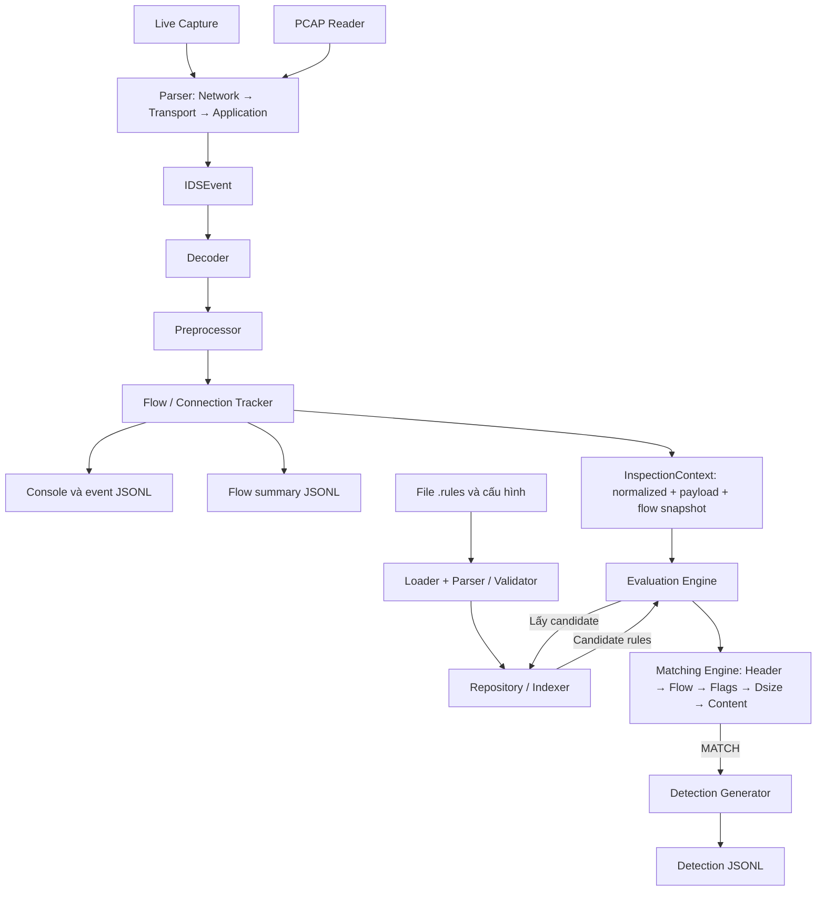

# NT204 – Xây dựng hệ thống IDS/IDPS theo mô-đun

**Trạng thái: đã triển khai Bài 1–3; Bài 3 có đủ hồ sơ kiểm thử T01–T14.**

## Giới thiệu

Repository phục vụ môn học NT204, xây dựng hệ thống IDS/IDPS theo kiến trúc mô-đun. Project hiện có các chức năng thu thập packet, phân tích giao thức, giải mã dữ liệu ứng dụng, tiền xử lý, theo dõi flow/kết nối và phát hiện theo rule Snort 2-style trong phạm vi được hỗ trợ.

**Assignment 01 – Packet Capture & Parser:**

- Bắt packet trực tiếp từ network interface hoặc đọc từ file PCAP.
- Phân tích IPv4, TCP và UDP; nhận diện HTTP/1.x, DNS và SMTP.
- Tạo `IDSEvent`, ghi thông tin phân tích và lỗi theo định dạng JSON Lines.
- Xử lý packet malformed và giao thức chưa hỗ trợ để tiếp tục với packet phía sau.

**Assignment 02 – Decoder, Preprocessor & Flow/Connection Tracker:**

- Giải mã HTTP URI, form, HTML entity và text theo charset; giải mã SMTP MIME Base64/Quoted-Printable.
- Kiểm tra tính hợp lệ của event, chuẩn hóa protocol/header/domain và bổ sung field tùy chọn bị thiếu.
- Gom packet hai chiều vào cùng flow, theo dõi TCP handshake, FIN/ACK, RST và idle timeout.
- Thống kê packet, byte, TCP flags và thời gian của flow; xuất flow summary riêng.

**Assignment 03 – Core Engine & Snort Rule Matching:**

- Nạp/parse/validate rule, phân loại valid/invalid/unsupported, cho phép tắt rule hoặc file rule bằng cấu hình.
- Chọn candidate theo protocol/port, so khớp header, flow/state, content/modifier, flags và dsize.
- Đánh giá toàn bộ candidate, cho phép nhiều rule match một event và thống kê số event/candidate/match.
- Sinh Detection Event thống nhất và ghi detection JSONL riêng khi bật `--rules`.


## Kiến trúc hệ thống

Hai nguồn dữ liệu dùng chung pipeline xử lý:




### Các lớp chính

| Lớp | Chức năng |
|---|---|
| Capture | Thu thập packet từ interface hoặc đọc PCAP |
| Core | Định nghĩa `IDSEvent`, cấu hình và điều phối pipeline |
| Network parser | Phân tích IPv4 |
| Transport parser | Phân tích TCP và UDP |
| Application parser | Nhận diện và phân tích HTTP/1.x, DNS, SMTP |
| Decoder | Giải mã dữ liệu ứng dụng, ghi status và lỗi |
| Preprocessor | Validation, normalization, bổ sung field thiếu và quyết định process/skip |
| Flow Tracker | Gom flow hai chiều, theo dõi trạng thái và thống kê |
| Rule Loader | Đọc nhiều file rule, bỏ comment/dòng trống, áp dụng cấu hình bật/tắt |
| Rule Parser / Validator | Chuyển rule text thành model, báo invalid/unsupported kèm lý do |
| Repository / Indexer | Lưu rule hợp lệ, chọn candidate theo protocol/port |
| Matching Engine | Kiểm tra header → flow → flags → dsize → content; loại sớm khi đã biết không match |
| Evaluation Engine | Duyệt candidate, giữ nhiều MATCH và counters cộng dồn |
| Detection Generator | Tạo detection từ MATCH cùng SID, giữ metadata packet/rule và evidence |
| Output | Ghi event, flow summary và detection vào các file JSONL riêng |

## Cấu trúc thư mục

```text
NT204.R11.ANTN_LePhamKhanhLinh_24520959/
├── ids/
│   ├── capture/              # Live capture và PCAP reader
│   ├── core/                 # Event, config và pipeline
│   ├── parsers/
│   │   ├── network/          # IPv4
│   │   ├── transport/        # TCP, UDP
│   │   └── application/      # HTTP, DNS, SMTP và detector
│   ├── decoder/              # HTTP, text, HTML, SMTP DATA và MIME
│   ├── preprocessor/         # Validation, normalization và policy
│   ├── flow_tracker/         # Identity, TCP state, statistics và tracker
│   ├── detection/            # Rule models/loader/parser/indexer, matchers, engine và generator
│   └── output/               # JSONL writer
├── TEST/
│   ├── README.md
│   ├── assignment_01/        # Live capture và 12 nhóm test offline
│   ├── assignment_02/        # T01–T14 và hồ sơ kết quả
│   └── assignment_03/        # T01–T14 Core Engine và Snort Rule Matching
├── .gitignore
├── main.py                   # CLI
├── README.md
└── requirements.txt
```

Sơ đồ lược bỏ các file `__init__.py` và chi tiết từng test để dễ đọc.

### Quy ước thư mục kiểm thử

Một test dùng PCAP thường có:

```text
test_xx_ten_test/
├── README.md
├── input.pcap
├── result.jsonl
├── console.txt
└── result_flows.jsonl        # Khi test cần kiểm tra flow summary
```

- `README.md`: mục tiêu, dữ liệu đầu vào, cách chạy, kết quả và giải thích.
- `input.pcap`: packet đầu vào, có ghi rõ nguồn dữ liệu.
- `result.jsonl`: một event cho mỗi packet được xử lý.
- `result_flows.jsonl`: thống kê flow; dùng cho các test Flow Tracker.
- `console.txt`: output khi chạy chương trình và kiểm tra.

Một số test có script `check_*.py` tự đối chiếu kết quả hoặc tạo event/context trực tiếp trong bộ nhớ. 

## Yêu cầu môi trường

- Python **3.10 trở lên**.
- Scapy **2.7.0**, được khai báo trong `requirements.txt`.
- Git để clone repository.
- Trên Windows: Npcap để live capture; quyền truy cập interface phù hợp.

Project được phát triển và kiểm thử trên Windows với PowerShell. Các lệnh bên dưới dùng môi trường này; Visual Studio Code là công cụ biên tập tùy chọn.

## Cài đặt

### 1. Clone repository

```powershell
git clone https://github.com/lyns184/NT204.R11.ANTN_LePhamKhanhLinh_24520959.git
cd NT204.R11.ANTN_LePhamKhanhLinh_24520959
```

### 2. Tạo virtual environment

```powershell
py -m venv .venv
```

### 3. Kích hoạt virtual environment

```powershell
.\.venv\Scripts\Activate.ps1
```

Các lệnh `python` tiếp theo dùng Python trong virtual environment đã kích hoạt. Có thể gọi trực tiếp `.\.venv\Scripts\python.exe` nếu không kích hoạt.

### 4. Cài đặt thư viện

```powershell
python -m pip install -r requirements.txt
python -c "import scapy; print(scapy.__version__)"
```

## Cách sử dụng

Chạy các lệnh tại thư mục gốc project. Xem tùy chọn CLI:

```powershell
python main.py --help
```

Chọn một trong hai nguồn: `--interface` để live capture hoặc `--pcap` để đọc file. Chương trình ghi event và flow summary; thêm `--rules` để ghi detection vào file riêng.

### Liệt kê network interface

```powershell
python -c "from scapy.all import show_interfaces; show_interfaces()"
```

### Live capture

Thay `Wi-Fi` bằng interface trên máy của bạn:

```powershell
python -X utf8 main.py `
  --interface "Wi-Fi" `
  --count 5 `
  --output output\live_events.jsonl `
  --flow-output output\live_flows.jsonl
```

`--count 0` (mặc định) bắt liên tục cho đến khi nhấn `Ctrl+C`. Live capture kiểm tra idle timeout cả khi không có packet mới.

### Đọc file PCAP

Ví dụ kiểm tra HTTP URL decoding bằng fixture T01:

```powershell
python -X utf8 main.py `
  --pcap TEST\assignment_02\test_01_http_url_decode\input.pcap `
  --output output\t01_events.jsonl `
  --flow-output output\t01_flows.jsonl
```

Để chạy fixture bài 1, thay đường dẫn PCAP bằng `TEST\assignment_01\test_01_tcp_handshake\input.pcap`.

### Bật Core Engine bằng rule

Ví dụ dùng fixture T14 Bài 3, có bốn packet HTTP/DNS/binary và ba detection:

```powershell
python -X utf8 main.py `
  --pcap TEST\assignment_03\test_14_detection_schema\input.pcap `
  --rules TEST\assignment_03\test_14_detection_schema\input.rules `
  --output output\detection_example\events.jsonl `
  --flow-output output\detection_example\flows.jsonl `
  --detection-output output\detection_example\detections.jsonl
```

| Tùy chọn | Ý nghĩa |
|---|---|
| `--rules` | File .rules; lặp lại tùy chọn để nạp nhiều file, theo thứ tự truyền vào |
| `--rule-config` | File JSON tắt SID/file; cần có `--rules` |
| `--detection-output` | File detection; mặc định `detections.jsonl` cạnh event output; cần có `--rules` |

Live capture dùng cùng nhánh detection: thêm `--rules <file.rules>` vào lệnh `--interface`. Event bị skip vẫn được ghi vào event JSONL nhưng không được đánh giá rule. Một event có thể tạo nhiều detection, mỗi SID tối đa một detection cho event đó. Các event sau vẫn được đánh giá dù cùng flow hoặc payload giống nhau.

Console có `[RULES]` với thống kê nạp rule, `[DETECTION SUMMARY]` với counters chạy Engine, và diagnostic `[DETECTION]` khi cần. Rule invalid/unsupported được báo lý do, loại toàn bộ rule rồi tiếp tục rule khác. Không còn rule hợp lệ đang bật hoặc không đọc được file rule đang bật thì chương trình báo thất bại. Các đường dẫn output phải khác nhau và không trùng input.

### Cấu hình tắt rule hoặc file rule

Mặc định các file được truyền bằng `--rules` và các rule hợp lệ trong đó đều bật. Ví dụ tạo `output/rule-config.json`, tắt toàn bộ file T13 và riêng SID101402 của T14:

```powershell
New-Item -ItemType Directory -Force output | Out-Null
@'
{
  "disabled_files": ["../TEST/assignment_03/test_13_multiple_matches/input.rules"],
  "disabled_sids": [101402]
}
'@ | Set-Content -Encoding UTF8 output\rule-config.json

python -X utf8 main.py `
  --pcap TEST\assignment_03\test_14_detection_schema\input.pcap `
  --rules TEST\assignment_03\test_13_multiple_matches\input.rules `
  --rules TEST\assignment_03\test_14_detection_schema\input.rules `
  --rule-config output\rule-config.json `
  --output output\config_example\events.jsonl `
  --flow-output output\config_example\flows.jsonl `
  --detection-output output\config_example\detections.jsonl
```

Đường dẫn `disabled_files` tính từ thư mục chứa JSON, nên `../TEST/...` ở ví dụ trên đi từ `output/` về root project. SID phải là số nguyên JSON. Ví dụ còn hai detection của T14: SID101401 và SID101403. Để bật lại, bỏ phần tử tương ứng khỏi danh sách hoặc bỏ `--rule-config`. File được liệt kê trong config không tự được nạp; đầu vào vẫn do các lần `--rules` quyết định.

### Phạm vi rule đang hỗ trợ

Mỗi rule Snort 2-style nằm trên một dòng, options trong ngoặc và kết thúc bằng dấu `;`. Ví dụ:

```text
alert tcp any any -> any 80 (msg:"Admin marker"; sid:101301; rev:1; content:"admin";)
```

| Nhóm | Phạm vi |
|---|---|
| Header | `alert`; `tcp`, `udp`, `ip`; IP any/IPv4/CIDR; port any/single/range, gồm range mở; `->`, `<>` |
| Identification | `msg`, `sid`, `rev`; SID enabled trùng thì giữ rule hợp lệ enabled đầu tiên |
| Content | `content`, hex block, `nocase`, `offset`, `depth`, `distance`, `within` |
| Packet/TCP | `flags` exact F/S/R/P/A/U/E/C hoặc `0`; `dsize:n`, `dsize:<n`, `dsize:>n`, literal 0–65535 |
| Flow | TCP `to_server`, `to_client`, `established`, `not_established`, theo bằng chứng Tracker |
| Classification | `classtype`, `priority`; thiếu thì detection ghi null |


## Các giao thức đang hỗ trợ

| Tầng | Giao thức | Thông tin được phân tích |
|---|---|---|
| Network | IPv4 | Độ dài header/packet, flags, TTL, checksum, IP nguồn/đích |
| Transport | TCP | Port, sequence/acknowledgment, flags, window, checksum, payload length |
| Transport | UDP | Port, length, checksum, payload length |
| Application | HTTP/1.x | Request/response, method, path, status code, header, body |
| Application | DNS | Query/response, transaction ID, questions và answers theo loại record |
| Application | SMTP | Command, argument, response code/message |

Nhận diện ứng dụng sử dụng cấu trúc payload và thông tin giao thức/port tùy trường hợp. SMTP DATA được Decoder theo dõi theo phiên để giải mã MIME; Parser không phân tích DATA như command/response.

## Cấu trúc IDS event

JSONL chứa một JSON độc lập trên mỗi dòng. Ví dụ rút gọn từ packet HTTP của T01, lược bỏ các field header và metadata phụ:

```json
{
  "packet_id": 4,
  "timestamp": 1700000000.3,
  "network": {"protocol": "IPv4", "src_ip": "10.0.0.1", "dst_ip": "10.0.0.2"},
  "transport": {"protocol": "TCP", "src_port": 12345, "dst_port": 80},
  "application": {"protocol": "HTTP", "fields": {"method": "GET", "path": "/search?q=hello%20world"}},
  "decoded": {"http": {"uri": {"value": "/search?q=hello world", "status": "ok", "errors": []}}},
  "decode_status": "ok",
  "preprocess_status": "valid",
  "processing_action": "process",
  "reason": null,
  "direction": "forward",
  "flow_tracking_status": "tracked"
}
```

Các nhóm field trong event đầy đủ:

| Field | Ý nghĩa |
|---|---|
| `packet_id`, `timestamp`, `capture_source` | Thứ tự, thời điểm và nguồn packet |
| `network`, `transport`, `application` | Kết quả Parser |
| `payload_length`, `packet_length` | Độ dài payload và độ dài packet nếu đã thu thập; field chưa có có thể là `null` |
| `parse_errors` | Lỗi phân tích |
| `decoded`, `decode_status`, `decode_errors` | Kết quả giải mã, trạng thái và lỗi Decoder |
| `normalized` | Bản chuẩn hóa riêng; giữ dữ liệu Parser/Decoder gốc |
| `preprocess_status`, `processing_action`, `reason` | Kết quả validation và quyết định xử lý |
| `flow_id`, `direction` | ID flow và chiều packet |
| `flow_tracking_status`, `flow_tracking_reason` | Kết quả theo dõi flow |


### Flow summary

File flow summary lưu thống kê của flow khi đóng, hết hạn hoặc kết thúc capture:

- `endpoint_a`, `endpoint_b`: hai đầu IP/port; A là phía gửi packet đầu tiên được quan sát.
- `flow_id`: liên kết summary với các event của flow; ID được tạo mới mỗi lần tạo flow.
- `forward`: A→B; `backward`: B→A. Hai chiều dùng cùng flow ID.
- `packet_count`, `byte_count`: tổng số packet và byte; thống kê từng chiều nằm trong `forward`/`backward`.
- `start_time`, `last_seen`, `duration`: thời điểm đầu/cuối và khoảng thời gian giữa chúng.
- `state`, `tcp_flags`, `handshake_observed`, `capture_midstream`: metadata TCP; là `null` với UDP.
- `close_reason`: lý do xuất summary, ví dụ `tcp_fin`, `tcp_reset`, `idle_timeout`, `capture_end`.


## Hạn chế hiện tại

- Core Engine hỗ trợ subset Snort 2-style được mô tả ở trên; chưa có module Alert/Response hoặc chức năng chặn traffic.
- Parser hiện hỗ trợ IPv4/TCP/UDP; chưa hỗ trợ IPv6 và các giao thức mạng khác.
- HTTP cần message/body đầy đủ trong packet; chưa có HTTP stream reassembly tổng quát, chunked decoding, gzip hoặc giải mã HTTPS/TLS.
- SMTP DATA có xử lý theo phiên và kiểm tra sequence trong phạm vi triển khai; chưa phải cơ chế TCP reassembly tổng quát.
- Content Matcher dùng raw payload đầy đủ của từng packet; không giải mã HTTPS/TLS hoặc tự áp dụng HTTP buffer keyword. Flow direction/established cho detection chỉ được xác nhận khi có đủ bằng chứng, có thể chưa biết khi capture giữa phiên.
- Kết quả test xác nhận những trường hợp được mô tả trong hồ sơ, chưa bao phủ mọi biến thể traffic thực tế.
- Lỗi của một packet/event được ghi nhận để tiếp tục xử lý; lỗi đọc file PCAP khiến không thể tiếp tục đọc được báo thất bại.

## Sử dụng công cụ AI

**Công cụ sử dụng: Codex**, trợ lý lập trình AI. Công cụ được dùng để giải thích yêu cầu, brainstorm/chia task, hỗ trợ viết và rà soát code, thiết kế fixture/assertion, chạy kiểm tra, phân tích lỗi, giải thích Python/Scapy/Git và soạn tài liệu/lệnh commit.
Dữ liệu tự tạo, event giả lập và kết quả kiểm tra được ghi rõ trong README từng test để người đọc có thể đối chiếu và tái hiện.

