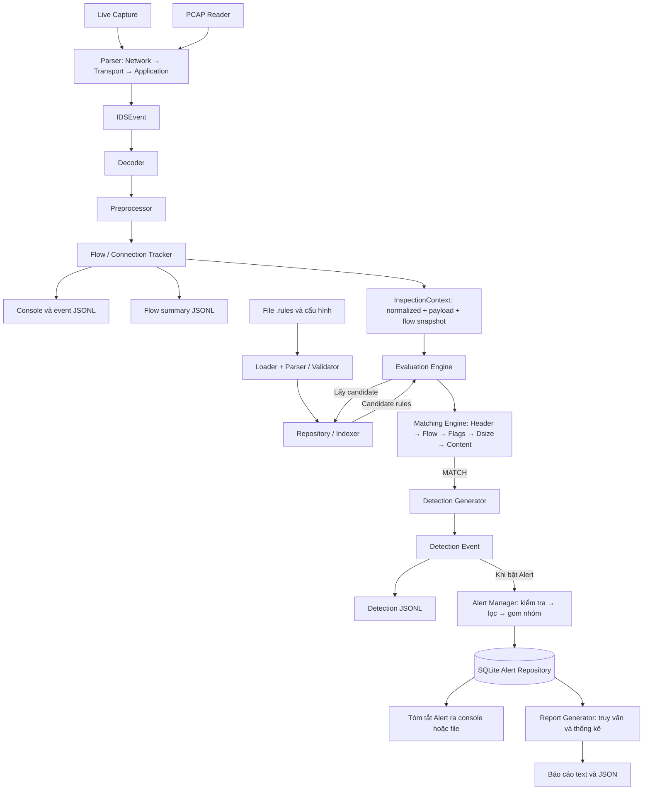

# NT204 – Xây dựng hệ thống IDS/IDPS theo mô-đun

## Giới thiệu

Đây là project môn NT204, xây dựng hệ thống IDS/IDPS theo từng mô-đun. Hệ thống bắt gói tin trực tiếp hoặc đọc PCAP, phân tích dữ liệu, theo dõi kết nối, phát hiện gói tin khớp rule, lưu cảnh báo và tạo báo cáo theo thời gian. Phần phát hiện hỗ trợ một số thành phần của cú pháp Snort 2 được liệt kê bên dưới.


## Kiến trúc hệ thống

Gói tin bắt trực tiếp và gói tin đọc từ PCAP đều đi qua cùng một quy trình xử lý:



### Các lớp chính

| Lớp | Chức năng |
|---|---|
| Capture | Bắt gói tin từ card mạng hoặc đọc file PCAP |
| Core | Định nghĩa `IDSEvent`, cấu hình và điều phối pipeline |
| Network parser | Phân tích IPv4 |
| Transport parser | Phân tích TCP và UDP |
| Application parser | Nhận diện và phân tích HTTP/1.x, DNS, SMTP |
| Decoder | Giải mã dữ liệu ứng dụng, ghi trạng thái và lỗi |
| Preprocessor | Kiểm tra, chuẩn hóa, bổ sung trường còn thiếu và quyết định xử lý hoặc bỏ qua event |
| Flow Tracker | Gom flow hai chiều, theo dõi trạng thái và thống kê |
| Rule Loader | Đọc nhiều file rule, bỏ comment/dòng trống, áp dụng cấu hình bật/tắt |
| Rule Parser / Validator | Phân tích rule thành cấu trúc dữ liệu, báo rõ lý do nếu rule không hợp lệ hoặc chưa được hỗ trợ |
| Repository / Indexer | Lưu rule hợp lệ và chọn các rule cần xét theo giao thức, port |
| Matching Engine | Kiểm tra lần lượt header → flow → flags → dsize → content; dừng kiểm tra rule ngay khi một điều kiện không khớp |
| Evaluation Engine | Duyệt các rule cần xét, ghi nhận tất cả rule khớp và cập nhật thống kê |
| Detection Generator | Tạo detection cho từng SID khớp, kèm thông tin gói tin, rule và dữ liệu làm căn cứ phát hiện |
| Alert Manager | Chuẩn hóa detection, ánh xạ severity, lọc theo cấu hình và gửi các lượt hợp lệ sang kho cảnh báo |
| Alert Repository | Lưu và gom nhóm trong SQLite, truy vấn Alert theo thời gian và metadata |
| Report Generator | Đọc alert đã lưu, tổng hợp số liệu và xuất báo cáo text và JSON |
| Output | Ghi event, flow summary và detection vào các file JSONL riêng |

## Cấu trúc thư mục

```text
NT204.R11.ANTN_LePhamKhanhLinh_24520959/
├── ids/
│   ├── capture/              # Live capture và PCAP reader
│   ├── core/                 # Event, config và pipeline
│   ├── parsers/
│   │   ├── network/          # IPv4
│   │   ├── transport/        # TCP, UDP
│   │   └── application/      # HTTP, DNS, SMTP và detector
│   ├── decoder/              # HTTP, text, HTML, SMTP DATA và MIME
│   ├── preprocessor/         # Validation, normalization và policy
│   ├── flow_tracker/         # Identity, TCP state, statistics và tracker
│   ├── detection/            # Rule models/loader/parser/indexer, matchers, engine và generator
│   ├── alert/                # Alert Object, cấu hình, bộ lọc, quản lý và lưu SQLite
│   ├── report/               # Thống kê, xuất text/JSON và lệnh report
│   └── output/               # JSONL writer
├── TEST/
│   ├── README.md
│   ├── assignment_01/        # Live capture và 12 nhóm test offline
│   ├── assignment_02/        # T01–T14 và hồ sơ kết quả
│   ├── assignment_03/        # T01–T14 Core Engine và Snort Rule Matching
│   └── assignment_04/        # TC01–TC14 Alert & Report
├── .gitignore
├── alert_config.example.json # Cấu hình mẫu Alert & Report
├── main.py                   # CLI
├── README.md
└── requirements.txt
```

Cây thư mục trên không liệt kê các file `__init__.py` và toàn bộ file trong từng test.

### Quy ước thư mục kiểm thử

Các test sử dụng PCAP thường được sắp xếp như sau:

```text
test_xx_ten_test/
├── README.md
├── input.pcap
├── result.jsonl
├── console.txt
└── result_flows.jsonl        # Khi test cần kiểm tra flow summary
```

- `README.md`: mô tả mục tiêu, dữ liệu đầu vào, cách chạy và kết quả của test.
- `input.pcap`: các gói tin dùng để kiểm thử. Nguồn dữ liệu được ghi trong README của test.
- `result.jsonl`: kết quả xử lý, mỗi gói tin tương ứng với một event.
- `result_flows.jsonl`: thống kê flow; dùng cho các test Flow Tracker.
- `console.txt`: nội dung hiển thị trên console khi chạy và kiểm tra kết quả.

Một số test có thêm script `check_*.py` để tự đối chiếu kết quả hoặc tạo event và context trực tiếp trong bộ nhớ.

## Yêu cầu môi trường

- Python **3.10 trở lên**.
- Scapy **2.7.0**, được khai báo trong `requirements.txt`.
- Alert & Report dùng `sqlite3` có sẵn trong Python. Chương trình tạo file SQLite tại `storage_path` khi bật Alert và cần quyền ghi vào thư mục đó.
- Git để tải mã nguồn.
- Nếu bắt gói tin trực tiếp trên Windows, cần cài Npcap và có quyền truy cập card mạng.

Project được phát triển và kiểm thử trên Windows bằng PowerShell, nên các lệnh bên dưới viết cho môi trường này. Có thể dùng Visual Studio Code hoặc trình soạn thảo khác để làm việc với mã nguồn.

## Cài đặt

### 1. Clone repository

```powershell
git clone https://github.com/lyns184/NT204.R11.ANTN_LePhamKhanhLinh_24520959.git
cd NT204.R11.ANTN_LePhamKhanhLinh_24520959
```

### 2. Tạo virtual environment

```powershell
py -m venv .venv
```

### 3. Kích hoạt virtual environment

```powershell
.\.venv\Scripts\Activate.ps1
```

Sau khi kích hoạt, lệnh `python` sẽ dùng Python trong môi trường ảo. Nếu không kích hoạt, có thể thay `python` bằng `.\.venv\Scripts\python.exe` trong các lệnh bên dưới.

### 4. Cài đặt thư viện

```powershell
python -m pip install -r requirements.txt
python -c "import scapy; print(scapy.__version__)"
```

## Cách sử dụng

Chạy các lệnh dưới đây tại thư mục gốc của project. Để xem các tùy chọn:

```powershell
python main.py --help
```

Dùng `--interface` để bắt gói tin trực tiếp hoặc `--pcap` để đọc file. Mỗi lần chạy chọn một nguồn. Chương trình ghi event và thống kê flow ra các file riêng. Thêm `--rules` để tạo detection và `--alert-config` để lưu thêm Alert vào SQLite. Lệnh `report` đọc SQLite trong một lần chạy riêng.

### Liệt kê network interface

```powershell
python -c "from scapy.all import show_interfaces; show_interfaces()"
```

### Live capture

Thay `Wi-Fi` bằng interface trên máy của bạn:

```powershell
python -X utf8 main.py `
  --interface "Wi-Fi" `
  --count 5 `
  --output output\live_events.jsonl `
  --flow-output output\live_flows.jsonl
```

`--count 0` (mặc định) bắt liên tục cho đến khi nhấn `Ctrl+C`. Trong chế độ bắt trực tiếp, chương trình vẫn kiểm tra thời gian hết hạn của flow khi không có gói tin mới.

### Đọc file PCAP

Ví dụ chạy bộ dữ liệu T01 để kiểm tra giải mã URL trong HTTP:

```powershell
python -X utf8 main.py `
  --pcap TEST\assignment_02\test_01_http_url_decode\input.pcap `
  --output output\t01_events.jsonl `
  --flow-output output\t01_flows.jsonl
```

Để chạy dữ liệu kiểm thử của Bài 1, thay đường dẫn PCAP bằng `TEST\assignment_01\test_01_tcp_handshake\input.pcap`.

### Lưu Alert từ PCAP hoặc live capture

Ví dụ dùng PCAP và rule của T13 Bài 3 để tạo detection và Alert:

```powershell
python -X utf8 main.py `
  --pcap TEST\assignment_03\test_13_multiple_matches\input.pcap `
  --rules TEST\assignment_03\test_13_multiple_matches\input.rules `
  --alert-config alert_config.example.json `
  --output output\assignment_04_demo\events.jsonl `
  --flow-output output\assignment_04_demo\flows.jsonl `
  --detection-output output\assignment_04_demo\detections.jsonl `
  --alert-output output\assignment_04_demo\alerts.txt
```

`--alert-config` cần `--rules`. Có thể thay `--pcap` bằng `--interface` để dùng cùng luồng khi bắt trực tiếp. Khi bỏ `--alert-output`, tóm tắt Alert của lần chạy được in ra console. Dòng `[ALERT SUMMARY]` ghi `run_id` và số lượt bị từ chối, bị lọc, tạo nhóm hoặc được gom.

File [cấu hình mẫu](alert_config.example.json) có các tùy chọn sau.

| Tùy chọn | Ý nghĩa và mặc định |
|---|---|
| `severity_mapping` | `1 → CRITICAL`, `2 → HIGH`, `3 → MEDIUM`, `4 → LOW`. Khi khai báo mapping riêng, mapping đó thay thế toàn bộ mapping mặc định. |
| `default_severity` | `LOW` khi priority thiếu hoặc nằm ngoài mapping. |
| `min_severity`, `suppressed_sids` | Mặc định nhận từ `LOW` và không suppress SID nào. Bộ lọc chạy trước khi lưu hoặc gom nhóm. |
| `aggregation_enabled`, `aggregation_window_seconds` | Mặc định bật gom với cửa sổ `60` giây. Khi tắt, mỗi detection qua bộ lọc tạo một Alert riêng. |
| `storage_type`, `storage_path` | Dùng `sqlite`, lưu tại `output/alerts.sqlite3` theo cấu hình mẫu. Đường dẫn tương đối tính từ thư mục chứa file cấu hình. |
| `top_n` | Số dòng tối đa của mỗi bảng xếp hạng trong báo cáo, mặc định `10`. |

Khóa gom gồm `run_id`, SID, IP nguồn, IP đích, transport protocol và application protocol. Một nhóm nhận lượt trong khoảng `[first_seen, first_seen + window)` theo timestamp detection. Các lượt được gom giữ chung `alert_id`, tăng `count` và cập nhật `last_seen`. Port và `flow_id` trong nhóm là thông tin đại diện từ detection đầu tiên. Các lần chạy dùng `run_id` riêng và có thể lưu chung một DB.

### Tạo báo cáo từ SQLite

Chạy sau ví dụ trên. Kỳ bên dưới bao phủ timestamp của PCAP mẫu.

```powershell
python -X utf8 main.py report `
  --alert-config alert_config.example.json `
  --from 2023-11-14T22:13:20Z `
  --to 2023-11-14T22:13:25Z `
  --text-output output\assignment_04_demo\report.txt `
  --json-output output\assignment_04_demo\report.json
```

Mốc thời gian dùng ISO 8601 có múi giờ, chẳng hạn `Z` hoặc `+07:00`. Lệnh mở DB ở chế độ chỉ đọc. Báo cáo mặc định lấy mọi lần chạy trong kỳ. Dùng `--run-id` với ID trong `[ALERT SUMMARY]` để chọn một lần chạy và `--top-n` để đổi số dòng xếp hạng. Bỏ `--text-output` để in bản text ra console. Bỏ `--json-output` để ghi `report.json` cạnh DB.

Báo cáo lấy nhóm có `first_seen` trong khoảng `[from, to)` và hiển thị các mốc theo UTC. `total_alerts` là số nhóm, còn `total_occurrences` là tổng `count` của các nhóm được chọn. Phân bố severity, SID, classtype, giao thức, IP và theo giờ đều đếm số nhóm. Nếu một nhóm bắt đầu ở giờ trước và kết thúc ở giờ sau, cả nhóm và toàn bộ `count` thuộc kỳ chứa `first_seen`. Kỳ rỗng trả báo cáo hợp lệ với số nhóm và số lượt bằng 0.

Với DB mới và một lần chạy PCAP mẫu, báo cáo có `total_alerts = 3` và `total_occurrences = 9`. Nếu chạy lại vào cùng DB, dùng `--run-id` để đối chiếu số liệu của một lần chạy.


### Phạm vi rule đang hỗ trợ

Mỗi rule viết theo cú pháp Snort 2 và nằm trên một dòng. Các tùy chọn đặt trong ngoặc, mỗi tùy chọn kết thúc bằng dấu `;`. Ví dụ:

```text
alert tcp any any -> any 80 (msg:"Admin marker"; sid:101301; rev:1; content:"admin";)
```

| Nhóm | Phạm vi |
|---|---|
| Header | `alert`; `tcp`, `udp`, `ip`; IP any/IPv4/CIDR; port any/single/range, gồm range mở; `->`, `<>` |
| Identification | `msg`, `sid`, `rev`; nếu các rule đang bật trùng SID, giữ rule hợp lệ đầu tiên |
| Content | `content`, hex block, `nocase`, `offset`, `depth`, `distance`, `within` |
| Packet/TCP | `flags` exact F/S/R/P/A/U/E/C hoặc `0`; `dsize:n`, `dsize:<n`, `dsize:>n`, literal 0–65535 |
| Flow | TCP `to_server`, `to_client`, `established`, `not_established`, theo bằng chứng Tracker |
| Classification | `classtype`, `priority`; nếu không có, detection ghi `null` |


## Cấu trúc IDS event

Trong file JSONL, mỗi dòng là một đối tượng JSON riêng. Dưới đây là event rút gọn từ gói tin HTTP của T01; một số trường header và metadata phụ đã được lược bỏ:

```json
{
  "packet_id": 4,
  "timestamp": 1700000000.3,
  "network": {"protocol": "IPv4", "src_ip": "10.0.0.1", "dst_ip": "10.0.0.2"},
  "transport": {"protocol": "TCP", "src_port": 12345, "dst_port": 80},
  "application": {"protocol": "HTTP", "fields": {"method": "GET", "path": "/search?q=hello%20world"}},
  "decoded": {"http": {"uri": {"value": "/search?q=hello world", "status": "ok", "errors": []}}},
  "decode_status": "ok",
  "preprocess_status": "valid",
  "processing_action": "process",
  "reason": null,
  "direction": "forward",
  "flow_tracking_status": "tracked"
}
```

Event đầy đủ gồm các nhóm trường sau:

| Field | Ý nghĩa |
|---|---|
| `packet_id`, `timestamp`, `capture_source` | Thứ tự, thời điểm và nguồn packet |
| `network`, `transport`, `application` | Kết quả Parser |
| `payload_length`, `packet_length` | Độ dài payload và gói tin nếu đã thu thập; trường chưa có dữ liệu có thể là `null` |
| `parse_errors` | Lỗi phân tích |
| `decoded`, `decode_status`, `decode_errors` | Kết quả giải mã, trạng thái và lỗi Decoder |
| `normalized` | Dữ liệu đã chuẩn hóa, lưu riêng với dữ liệu gốc từ Parser và Decoder |
| `preprocess_status`, `processing_action`, `reason` | Kết quả kiểm tra tính hợp lệ và quyết định xử lý |
| `flow_id`, `direction` | ID flow và chiều của gói tin |
| `flow_tracking_status`, `flow_tracking_reason` | Kết quả theo dõi flow |

## Sử dụng công cụ AI

Project có sử dụng Codex để hỗ trợ đọc hiểu yêu cầu, lên ý tưởng và chia công việc, viết và rà soát mã nguồn, chuẩn bị dữ liệu cùng điều kiện kiểm tra, chạy test và phân tích lỗi. Codex cũng được dùng để giải thích cách sử dụng Python, Scapy, Git và hỗ trợ soạn tài liệu, lệnh commit.


Các dữ liệu tự tạo, event giả lập và kết quả kiểm tra được ghi rõ trong README của từng test để người đọc có thể đối chiếu và chạy lại.
