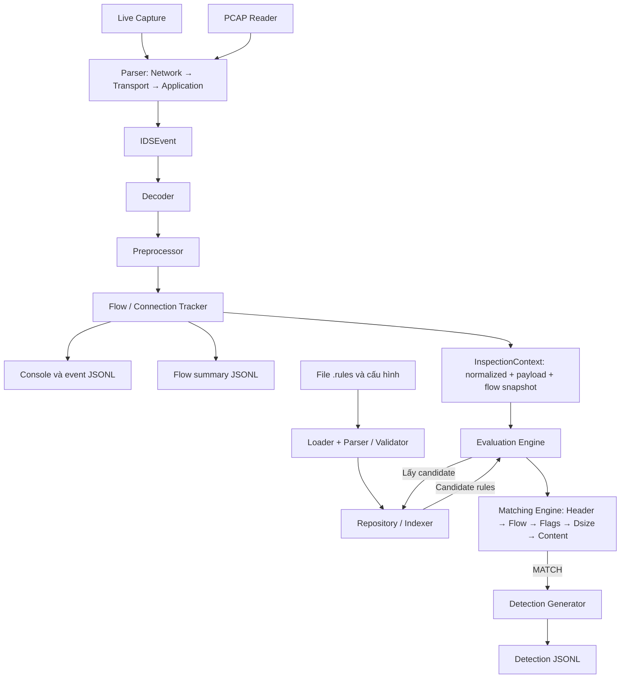

# NT204 – Xây dựng hệ thống IDS/IDPS theo mô-đun

## Giới thiệu

Đây là project môn NT204, xây dựng hệ thống IDS/IDPS theo từng mô-đun. Hệ thống có thể bắt gói tin trực tiếp hoặc đọc file PCAP, phân tích dữ liệu, theo dõi kết nối và phát hiện các gói tin khớp với rule. Phần phát hiện hiện hỗ trợ một số thành phần của cú pháp Snort 2, được liệt kê bên dưới.

**Assignment 01 – Packet Capture & Parser:**

- Bắt gói tin trực tiếp từ card mạng hoặc đọc từ file PCAP.
- Phân tích IPv4, TCP và UDP; nhận diện HTTP/1.x, DNS và SMTP.
- Tạo `IDSEvent` cho gói tin và ghi kết quả phân tích, lỗi vào file JSON Lines.
- Ghi nhận gói tin sai định dạng hoặc giao thức chưa hỗ trợ, sau đó tiếp tục xử lý các gói tin còn lại.

**Assignment 02 – Decoder, Preprocessor & Flow/Connection Tracker:**

- Giải mã URI, form, HTML entity và văn bản theo charset trong HTTP; giải mã Base64/Quoted-Printable trong SMTP MIME.
- Kiểm tra event, chuẩn hóa tên giao thức, header, domain và bổ sung các trường tùy chọn còn thiếu.
- Gom các gói tin hai chiều vào cùng một flow; theo dõi quá trình bắt tay TCP, FIN/ACK, RST và thời gian không hoạt động.
- Thống kê số gói tin, số byte, cờ TCP và thời gian của từng flow, rồi ghi vào file tổng kết riêng.

**Assignment 03 – Core Engine & Snort Rule Matching:**

- Đọc và kiểm tra rule, phân loại thành hợp lệ, không hợp lệ hoặc chưa hỗ trợ. Có thể tắt từng rule hoặc cả file rule bằng cấu hình.
- Chọn các rule cần kiểm tra theo giao thức và port, sau đó so khớp header, trạng thái flow, nội dung và các tùy chọn đi kèm, cờ TCP, kích thước payload.
- Kiểm tra tất cả rule đã chọn. Một event có thể khớp nhiều rule; số event, số rule được xét và số lượt khớp được thống kê trong quá trình chạy.
- Tạo Detection Event theo cùng một cấu trúc và ghi vào file JSONL riêng khi sử dụng `--rules`.

## Kiến trúc hệ thống

Gói tin bắt trực tiếp và gói tin đọc từ PCAP đều đi qua cùng một quy trình xử lý:



### Các lớp chính

| Lớp | Chức năng |
|---|---|
| Capture | Bắt gói tin từ card mạng hoặc đọc file PCAP |
| Core | Định nghĩa `IDSEvent`, cấu hình và điều phối pipeline |
| Network parser | Phân tích IPv4 |
| Transport parser | Phân tích TCP và UDP |
| Application parser | Nhận diện và phân tích HTTP/1.x, DNS, SMTP |
| Decoder | Giải mã dữ liệu ứng dụng, ghi trạng thái và lỗi |
| Preprocessor | Kiểm tra, chuẩn hóa, bổ sung trường còn thiếu và quyết định xử lý hoặc bỏ qua event |
| Flow Tracker | Gom flow hai chiều, theo dõi trạng thái và thống kê |
| Rule Loader | Đọc nhiều file rule, bỏ comment/dòng trống, áp dụng cấu hình bật/tắt |
| Rule Parser / Validator | Phân tích rule thành cấu trúc dữ liệu, báo rõ lý do nếu rule không hợp lệ hoặc chưa được hỗ trợ |
| Repository / Indexer | Lưu rule hợp lệ và chọn các rule cần xét theo giao thức, port |
| Matching Engine | Kiểm tra lần lượt header → flow → flags → dsize → content; dừng kiểm tra rule ngay khi một điều kiện không khớp |
| Evaluation Engine | Duyệt các rule cần xét, ghi nhận tất cả rule khớp và cập nhật thống kê |
| Detection Generator | Tạo detection cho từng SID khớp, kèm thông tin gói tin, rule và dữ liệu làm căn cứ phát hiện |
| Output | Ghi event, flow summary và detection vào các file JSONL riêng |

## Cấu trúc thư mục

```text
NT204.R11.ANTN_LePhamKhanhLinh_24520959/
├── ids/
│   ├── capture/              # Live capture và PCAP reader
│   ├── core/                 # Event, config và pipeline
│   ├── parsers/
│   │   ├── network/          # IPv4
│   │   ├── transport/        # TCP, UDP
│   │   └── application/      # HTTP, DNS, SMTP và detector
│   ├── decoder/              # HTTP, text, HTML, SMTP DATA và MIME
│   ├── preprocessor/         # Validation, normalization và policy
│   ├── flow_tracker/         # Identity, TCP state, statistics và tracker
│   ├── detection/            # Rule models/loader/parser/indexer, matchers, engine và generator
│   └── output/               # JSONL writer
├── TEST/
│   ├── README.md
│   ├── assignment_01/        # Live capture và 12 nhóm test offline
│   ├── assignment_02/        # T01–T14 và hồ sơ kết quả
│   └── assignment_03/        # T01–T14 Core Engine và Snort Rule Matching
├── .gitignore
├── main.py                   # CLI
├── README.md
└── requirements.txt
```

Cây thư mục trên không liệt kê các file `__init__.py` và toàn bộ file trong từng test.

### Quy ước thư mục kiểm thử

Các test sử dụng PCAP thường được sắp xếp như sau:

```text
test_xx_ten_test/
├── README.md
├── input.pcap
├── result.jsonl
├── console.txt
└── result_flows.jsonl        # Khi test cần kiểm tra flow summary
```

- `README.md`: mô tả mục tiêu, dữ liệu đầu vào, cách chạy và kết quả của test.
- `input.pcap`: các gói tin dùng để kiểm thử. Nguồn dữ liệu được ghi trong README của test.
- `result.jsonl`: kết quả xử lý, mỗi gói tin tương ứng với một event.
- `result_flows.jsonl`: thống kê flow; dùng cho các test Flow Tracker.
- `console.txt`: nội dung hiển thị trên console khi chạy và kiểm tra kết quả.

Một số test có thêm script `check_*.py` để tự đối chiếu kết quả hoặc tạo event và context trực tiếp trong bộ nhớ.

## Yêu cầu môi trường

- Python **3.10 trở lên**.
- Scapy **2.7.0**, được khai báo trong `requirements.txt`.
- Git để tải mã nguồn.
- Nếu bắt gói tin trực tiếp trên Windows, cần cài Npcap và có quyền truy cập card mạng.

Project được phát triển và kiểm thử trên Windows bằng PowerShell, nên các lệnh bên dưới viết cho môi trường này. Có thể dùng Visual Studio Code hoặc trình soạn thảo khác để làm việc với mã nguồn.

## Cài đặt

### 1. Clone repository

```powershell
git clone https://github.com/lyns184/NT204.R11.ANTN_LePhamKhanhLinh_24520959.git
cd NT204.R11.ANTN_LePhamKhanhLinh_24520959
```

### 2. Tạo virtual environment

```powershell
py -m venv .venv
```

### 3. Kích hoạt virtual environment

```powershell
.\.venv\Scripts\Activate.ps1
```

Sau khi kích hoạt, lệnh `python` sẽ dùng Python trong môi trường ảo. Nếu không kích hoạt, có thể thay `python` bằng `.\.venv\Scripts\python.exe` trong các lệnh bên dưới.

### 4. Cài đặt thư viện

```powershell
python -m pip install -r requirements.txt
python -c "import scapy; print(scapy.__version__)"
```

## Cách sử dụng

Chạy các lệnh dưới đây tại thư mục gốc của project. Để xem các tùy chọn:

```powershell
python main.py --help
```

Dùng `--interface` để bắt gói tin trực tiếp hoặc `--pcap` để đọc file; mỗi lần chạy chọn một nguồn. Chương trình ghi event và thống kê flow ra các file riêng. Khi thêm `--rules`, chương trình kiểm tra rule và ghi thêm file detection.

### Liệt kê network interface

```powershell
python -c "from scapy.all import show_interfaces; show_interfaces()"
```

### Live capture

Thay `Wi-Fi` bằng interface trên máy của bạn:

```powershell
python -X utf8 main.py `
  --interface "Wi-Fi" `
  --count 5 `
  --output output\live_events.jsonl `
  --flow-output output\live_flows.jsonl
```

`--count 0` (mặc định) bắt liên tục cho đến khi nhấn `Ctrl+C`. Trong chế độ bắt trực tiếp, chương trình vẫn kiểm tra thời gian hết hạn của flow khi không có gói tin mới.

### Đọc file PCAP

Ví dụ chạy bộ dữ liệu T01 để kiểm tra giải mã URL trong HTTP:

```powershell
python -X utf8 main.py `
  --pcap TEST\assignment_02\test_01_http_url_decode\input.pcap `
  --output output\t01_events.jsonl `
  --flow-output output\t01_flows.jsonl
```

Để chạy dữ liệu kiểm thử của Bài 1, thay đường dẫn PCAP bằng `TEST\assignment_01\test_01_tcp_handshake\input.pcap`.


### Phạm vi rule đang hỗ trợ

Mỗi rule viết theo cú pháp Snort 2 và nằm trên một dòng. Các tùy chọn đặt trong ngoặc, mỗi tùy chọn kết thúc bằng dấu `;`. Ví dụ:

```text
alert tcp any any -> any 80 (msg:"Admin marker"; sid:101301; rev:1; content:"admin";)
```

| Nhóm | Phạm vi |
|---|---|
| Header | `alert`; `tcp`, `udp`, `ip`; IP any/IPv4/CIDR; port any/single/range, gồm range mở; `->`, `<>` |
| Identification | `msg`, `sid`, `rev`; nếu các rule đang bật trùng SID, giữ rule hợp lệ đầu tiên |
| Content | `content`, hex block, `nocase`, `offset`, `depth`, `distance`, `within` |
| Packet/TCP | `flags` exact F/S/R/P/A/U/E/C hoặc `0`; `dsize:n`, `dsize:<n`, `dsize:>n`, literal 0–65535 |
| Flow | TCP `to_server`, `to_client`, `established`, `not_established`, theo bằng chứng Tracker |
| Classification | `classtype`, `priority`; nếu không có, detection ghi `null` |

## Các giao thức đang hỗ trợ

| Tầng | Giao thức | Thông tin được phân tích |
|---|---|---|
| Network | IPv4 | Độ dài header/packet, flags, TTL, checksum, IP nguồn/đích |
| Transport | TCP | Port, sequence/acknowledgment, flags, window, checksum, payload length |
| Transport | UDP | Port, length, checksum, payload length |
| Application | HTTP/1.x | Request/response, method, path, status code, header, body |
| Application | DNS | Query/response, transaction ID, questions và answers theo loại record |
| Application | SMTP | Command, argument, response code/message |

Tùy giao thức, hệ thống nhận diện ứng dụng dựa vào cấu trúc payload và thông tin giao thức hoặc port. Riêng SMTP DATA được Decoder theo dõi theo phiên để giải mã MIME; Parser không xử lý phần này như các lệnh và phản hồi SMTP.

## Cấu trúc IDS event

Trong file JSONL, mỗi dòng là một đối tượng JSON riêng. Dưới đây là event rút gọn từ gói tin HTTP của T01; một số trường header và metadata phụ đã được lược bỏ:

```json
{
  "packet_id": 4,
  "timestamp": 1700000000.3,
  "network": {"protocol": "IPv4", "src_ip": "10.0.0.1", "dst_ip": "10.0.0.2"},
  "transport": {"protocol": "TCP", "src_port": 12345, "dst_port": 80},
  "application": {"protocol": "HTTP", "fields": {"method": "GET", "path": "/search?q=hello%20world"}},
  "decoded": {"http": {"uri": {"value": "/search?q=hello world", "status": "ok", "errors": []}}},
  "decode_status": "ok",
  "preprocess_status": "valid",
  "processing_action": "process",
  "reason": null,
  "direction": "forward",
  "flow_tracking_status": "tracked"
}
```

Event đầy đủ gồm các nhóm trường sau:

| Field | Ý nghĩa |
|---|---|
| `packet_id`, `timestamp`, `capture_source` | Thứ tự, thời điểm và nguồn packet |
| `network`, `transport`, `application` | Kết quả Parser |
| `payload_length`, `packet_length` | Độ dài payload và gói tin nếu đã thu thập; trường chưa có dữ liệu có thể là `null` |
| `parse_errors` | Lỗi phân tích |
| `decoded`, `decode_status`, `decode_errors` | Kết quả giải mã, trạng thái và lỗi Decoder |
| `normalized` | Dữ liệu đã chuẩn hóa, lưu riêng với dữ liệu gốc từ Parser và Decoder |
| `preprocess_status`, `processing_action`, `reason` | Kết quả kiểm tra tính hợp lệ và quyết định xử lý |
| `flow_id`, `direction` | ID flow và chiều của gói tin |
| `flow_tracking_status`, `flow_tracking_reason` | Kết quả theo dõi flow |

### Flow summary

Thống kê của một flow được ghi ra file khi flow đóng, hết thời gian chờ hoặc quá trình thu thập gói tin kết thúc:

- `endpoint_a`, `endpoint_b`: địa chỉ IP và port của hai đầu kết nối. A là phía gửi gói tin đầu tiên được quan sát.
- `flow_id`: liên kết bản tổng kết với các event thuộc flow. Mỗi flow mới có một ID mới.
- `forward`: chiều A→B; `backward`: chiều B→A. Hai chiều dùng chung một flow ID.
- `packet_count`, `byte_count`: tổng số gói tin và byte; thống kê từng chiều nằm trong `forward`/`backward`.
- `start_time`, `last_seen`, `duration`: thời điểm đầu/cuối và khoảng thời gian giữa chúng.
- `state`, `tcp_flags`, `handshake_observed`, `capture_midstream`: thông tin trạng thái TCP. Các trường này có giá trị `null` với UDP.
- `close_reason`: lý do ghi bản tổng kết, ví dụ `tcp_fin`, `tcp_reset`, `idle_timeout`, `capture_end`.


## Sử dụng công cụ AI

Project có sử dụng Codex để hỗ trợ đọc hiểu yêu cầu, lên ý tưởng và chia công việc, viết và rà soát mã nguồn, chuẩn bị dữ liệu cùng điều kiện kiểm tra, chạy test và phân tích lỗi. Codex cũng được dùng để giải thích cách sử dụng Python, Scapy, Git và hỗ trợ soạn tài liệu, lệnh commit.

Các dữ liệu tự tạo, event giả lập và kết quả kiểm tra được ghi rõ trong README của từng test để người đọc có thể đối chiếu và chạy lại.
